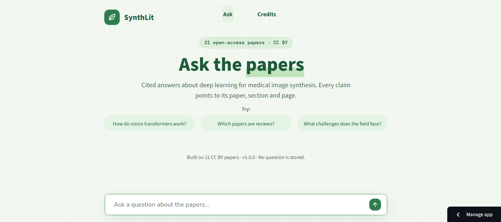
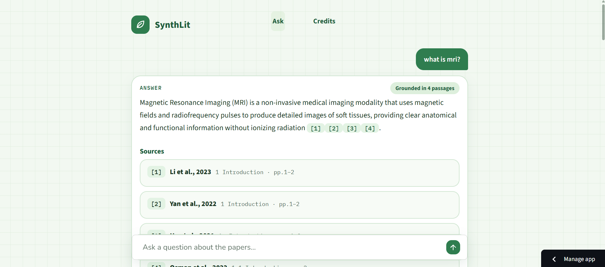
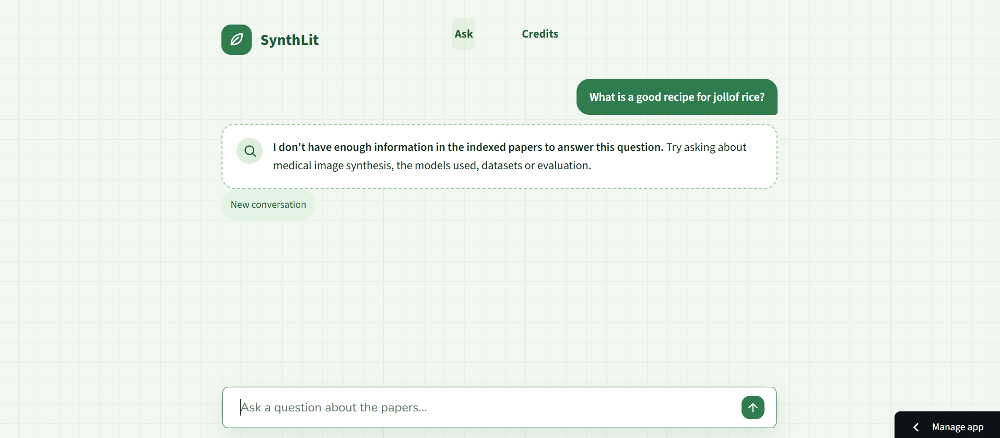
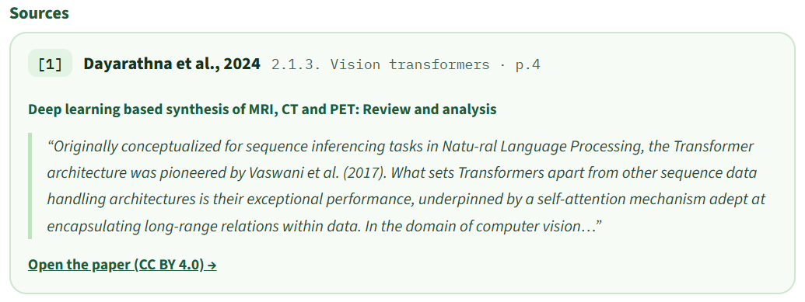

# SynthLit — cited Q&A over deep-learning papers on medical image synthesis

> Ask a question in plain language and get an answer grounded in 21 open-access papers,
> with numbered citations (paper, section, pages). If the papers do not contain
> the answer, the assistant says so instead of guessing.

**[▶ Live demo](https://synthlit-app-ravwypnv62c6kzfhdsniyd.streamlit.app/)** · v1.0.0
<sub>(free hosting: the app sleeps after 12 h without visits; the first click wakes it up in about a minute)</sub>





| A question outside the papers is refused | Sources are cards with the exact excerpt |
|---|---|
|  |  |

---

## What it does

- Answers questions about a fixed collection of 21 CC BY papers (reviews and method papers on MRI/CT/PET synthesis, GANs, transformers, diffusion models, CBCT-to-CT for radiotherapy).
- Every statement carries a citation `[n]` that points to the exact passage: article, section, pages. In the app, `[n]` is clickable and opens a card with the excerpt and a link to the paper.
- Questions about the collection itself ("which papers are reviews?") are answered from a catalogue and cited `[catalogue]`.
- Off-topic questions, including prompt-injection attempts, are refused.
- Follow-up questions work ("and for PET?") thanks to a conversation memory that is kept in RAM only.
- Nothing about the user's questions is stored.

## How it works

```
PDF ──► extraction ──► reading order ──► cleaning ──► chunks by section ──► table descriptions ──► index (Chroma)
        (hi_res)        (reorder)        (clean)       (≤450 tokens)         (LLM, for embedding)    + chunks.jsonl

question + history ─► standalone question ─► 3 queries (1 + 2 rewrites) ─► hybrid search per query
                                                                              (0.7 semantic + 0.3 BM25, weighted RRF, 10 each)
                                      ─► RRF over the 3 lists (10) ─► cross-encoder rerank (5) ─► LLM answer with [n] citations
                                                                                                  ─► citation check ─► Streamlit chat
```

**Ingestion** (`scripts/build_index.py`) — runs once, offline
- Text and tables are extracted with `unstructured` (hi_res); the raw output is cached as JSON because it is slow to produce.
- Reading order is repaired for two-column pages, headers/footers and boilerplate are removed.
- Chunks follow the paper structure: one chunk per section or subsection, split at ≤ 450 tokens (embedding-model tokens) with a 60-token overlap made of whole sentences. A table never forms a chunk on its own.
- Tables keep their **original HTML** in the metadata. For search, an LLM writes a short description of each table that is appended to the text used for the embedding; the answering LLM always receives the original text and the original table, never the description.
- Each chunk is embedded with a header `Author et al., year · section` using `BAAI/bge-small-en-v1.5` and stored in Chroma (cosine). The same chunks are written to `chunks.jsonl` for the keyword search.

**Retrieval** (`rag/retrieval/`)
- A follow-up question is rewritten into a standalone question using the chat history.
- The LLM produces 2 alternative queries with structured output (`json_schema`); with the original, 3 queries are searched. If it fails, the original question is used alone.
- Each query runs a semantic search and a BM25 keyword search, merged with weighted Reciprocal Rank Fusion (0.7 / 0.3 on ranks, k = 60) down to 10 chunks.
- The three lists are fused again with RRF (10 candidates), then a cross-encoder (`ms-marco-MiniLM-L-6-v2`) keeps the best 5.
- Multi-query, hybrid search and reranking each have an on/off switch in `config/settings.yaml` so they can be measured separately.

**Generation** (`rag/generation/`)
- Groq `openai/gpt-oss-20b`, temperature 0. The prompt contains the 5 numbered passages and a compact catalogue of the 21 papers.
- Citations are validated by code: only `[1]`–`[5]` and `[catalogue]` are accepted; one retry on invalid or missing citations, then invalid numbers are stripped.
- Chat memory keeps the last 4 exchanges without their citations, so numbering never clashes between turns.

**App** (`app.py`, `pages/`, `ui/`) — Streamlit
- A chat: the question box is at the bottom, answers appear above, oldest first. Each answer is a card with a "Grounded in N passages" badge and collapsible source cards (article, section, pages, excerpt, link and licence).
- The pipeline (index, BM25, reranker, LLM client) is loaded **once** per server with `@st.cache_resource`; each visitor has their own chat memory in `st.session_state`.
- Everything coming from the model or from a PDF is HTML-escaped before display; only `http(s)` links are rendered.
- Rate limits of the free LLM tier are turned into clear messages (per-minute limit: "wait about a minute"; daily limit: "come back tomorrow") instead of a stack trace.
- The **Credits** page is generated from the sources table (title, authors, year, licence with a link to the Creative Commons text), so it cannot drift from the data.
- Look: a green "scientific" design (grid paper background, mono citation chips), designed as a mockup first and then implemented.

## Design decisions and options

Each choice is a trade-off. This table says what I chose, why, and what I gave up.

| Area | Choice | Why | Trade-off / alternative |
|---|---|---|---|
| Corpus | 21 papers, **CC BY only**, picked and checked one by one | Excerpts can be shown publicly with attribution | NC/ND papers excluded even if relevant; small corpus |
| Extraction | `unstructured` hi_res + JSON cache | Two-column layout and tables need layout analysis | Slow and heavy (poppler, tesseract), so it runs offline only; some headings are mis-detected |
| Chunking | By section, ≤ 450 tokens, 60-token overlap | Papers are structured; a section is a natural, citable unit; 450 + header fits the 512-token limit of the embedding model | Fixed-size chunks are simpler but cut across sections and give vaguer citations |
| Tables | LLM description used **only** for the embedding | Raw tables embed badly, but the answer must use the exact table | One extra LLM call per table at indexing time |
| Embeddings | `bge-small-en-v1.5`, local | Free, runs on CPU, good enough for English papers | Larger models may retrieve better but need more memory (the free host has limited RAM) |
| Vector store | Chroma, persistent on disk, cosine | No server to run; the folder is shipped with the app | Not meant for millions of chunks (not needed here) |
| Keyword search | BM25 (`rank-bm25`) next to the semantic search | Acronyms and exact terms (PSNR, CycleGAN) are matched literally | Another index to keep in sync (built from `chunks.jsonl`) |
| Fusion | Weighted RRF, 0.7 / 0.3, k = 60 | Merges ranks, not scores, so no score calibration is needed | Weights are a reasonable default, not tuned (not ablated) |
| Multi-query | Original + 2 LLM rewrites | Recovers from wording mismatch between question and paper | +1 LLM call of latency; falls back to the question alone if it fails |
| Reranker | Cross-encoder MiniLM-L6, 10 → 5 | Reads question and passage together; first relevant passage moves from rank 2.3 to 1.1 | Small model, small sample: indication, not proof |
| LLM | Groq `gpt-oss-20b`, temperature 0 | Free tier, fast, deterministic answers | Rate limits (per minute and per day) and a free API that can change |
| Citations | Numbers `[1]`–`[5]` validated by code, one retry | A cited number must point to a real passage | A valid number does not prove the claim is supported (see faithfulness) |
| Memory | Last 4 exchanges, in RAM, citations stripped | Enables follow-ups, nothing stored, no numbering clash | Long conversations forget the beginning |
| UI | Streamlit | A real app in Python, no separate frontend | Reruns the script on each interaction; custom look needs CSS |
| Hosting | Streamlit Community Cloud | Free, deploys from GitHub, secrets handled by the platform | Sleeps after 12 h; limited memory. Hugging Face Docker Spaces would have been my first choice, but they now require a paid plan |
| Reproducibility | `scripts/make_requirements.py` pins the installed versions | A Chroma index must be read with the version that wrote it | Pins are for my Python version |

### Configuration (`config/settings.yaml`)

| Setting | Default | What it does |
|---|---|---|
| `retrieval.use_multiquery` / `use_hybrid` / `use_rerank` | `true` | Switch each retrieval step off to measure it |
| `retrieval.n_extra_queries` | 2 | Number of rewritten queries added to the original |
| `retrieval.k_per_query` / `k_candidates` / `k_final` | 10 / 10 / 5 | List sizes at each stage; `k_final` is what the LLM sees |
| `retrieval.weight_semantic` / `weight_keyword` / `rrf_k` | 0.7 / 0.3 / 60 | Fusion weights |
| `retrieval.history_turns` | 4 | Exchanges kept in the chat memory |
| `generation.max_retries` / `max_table_chars` | 1 / 3000 | Citation retry; size cap of a table sent to the LLM |
| `llm.model` / `llm.temperature` | `openai/gpt-oss-20b` / 0 | Answer model |
| `app.examples`, `app.max_question_chars`, `app.name` | see file | Example questions, question length limit, name in the header |

## Evaluation

**Protocol.** 14 hand-written questions over the 21 indexed papers: 8 answerable from a passage
(specific facts, definitions, a comparison, a discussion question, a dataset/table question),
1 catalogue question and 5 off-topic questions (including a prompt-injection attempt).
3 questions were held out and never used to tune anything. The gold passage is an
article + section + pages written by me; for 4 questions it was first seeded from the system's
output and then checked against the papers. Retrieval and generation are measured separately.

| Metric | Result |
|---|---|
| Recall@10 (gold passage in the 10 candidates) | 0.875 (7/8) |
| Recall@5 (still there after reranking) | 0.875 (7/8) |
| Off-topic questions refused | 5/5 |
| Answerable questions wrongly refused | 1 (q05) |
| Answers with valid citation numbers | 100% |
| Faithfulness (claims supported by the retrieved passages) | 85% (34/40 claims, 7 answers checked by hand) |

**Reranker ablation** (same questions, same gold):

| Config | Recall@10 | Recall@5 | Avg rank of 1st relevant passage | Wrongly refused |
|---|---|---|---|---|
| With reranker (default) | 0.88 | 0.88 | 2.29 → 1.14 | 1 |
| Without reranker | 0.88 | 0.88 | 1.57 | 2 |

Recall is identical, but the reranker moves the first relevant passage from rank 2.3 to 1.1
and one more answerable question was refused without it (q02, in both runs I made without it).
With 8 answerable questions this is an indication, not a proof; I kept the reranker.
Hybrid search and multi-query were not ablated in v1.

**What works.** Questions answered by one passage (facts, definitions, a table question) are
retrieved reliably, off-topic questions are always refused, and every answer carries
validated citations.

**What the evaluation changed.** Refusals are now detected with a language-independent marker
(translated refusals were not recognised), the refusal rule was softened (an answerable question
was refused), requests retry on Groq rate limits, and an incomplete gold passage list was fixed.

Reproduce: `python scripts/eval.py --name baseline` then `python scripts/compare.py data/eval/runs/baseline data/eval/runs/sans_rerank`
(questions live in `data/eval/questions.yaml`; `scripts/find_gold.py` finds passages, `scripts/explain.py` shows where a gold passage is lost).

## Known limits

- **Faithfulness is 85%, not 100%.** Short factual answers are fully supported; long explanatory answers mix retrieved content with the model's background knowledge, and an odd sentence can slip in. A citation guarantees that the passage exists, not that it supports the sentence. 
- **Wording sensitivity.** The generic question "What are different learning paradigms…" misses the dedicated section (the 5 retained passages are generic review chunks) and the system correctly refuses.
- **Broad, cross-paper questions** are poorly covered. q06 ("body regions") counts as a hit because my gold is broad, but the answer only lists the brain and whole-body; the retained passages often come from one review.
- **Small sample.** One question moves a score by ~7 points. Only one table question was tested. Gold for 4 questions was seeded from the system's output, so recall on those may be slightly optimistic.
- **English only.** The interface, the refusal message, the embedding model and the papers are English. Other languages were not evaluated and retrieval is expected to be weaker. Equations and figures are not indexed, and some headings are mis-detected by the extraction (some excerpts show glued words from the PDF text layer).
- **Free tier limits.** The Groq free tier limits tokens per minute and per day; the app shows a clear message and the evaluation script retries automatically. The hosting sleeps after 12 h without visits.

## Project structure

```
app.py             Streamlit chat page
pages/Credits.py   credits and licences, generated from the sources table
ui/                theme.py (CSS, header), render.py (citations, source cards, escaping)
.streamlit/        theme and server settings
config/            settings.yaml (numbers, paths, on/off switches) and prompts/
data/              clean_sources.csv, chunks.jsonl, index/, eval/ (questions.yaml, runs/)
rag/ingestion/     extraction cache, reorder, clean, chunk_by_section, tables, index, pipeline
rag/retrieval/     queries, search (Chroma + BM25), fusion (RRF), rerank, retriever
rag/generation/    prompt, citations, answer
rag/               pipeline.py (RagPipeline, Conversation), evaluation.py, sources.py, config.py, types.py
scripts/           build_index.py, chat.py, eval.py, compare.py, find_gold.py, explain.py, make_requirements.py
tests/             unit tests with fake components (no model, no network)
requirements.txt   app dependencies (pinned), used by the hosting
```

## Run it locally

```bash
python -m venv .venv && source .venv/bin/activate          # Windows: .venv\Scripts\activate
pip install -r requirements.txt                            # enough to run the app on the shipped index
echo "GROQ_API_KEY=your_key" > .env                        # never commit .env
streamlit run app.py                                       # the web app
python scripts/chat.py --debug                             # terminal chat; --no-rerank / --no-hybrid / --no-multiquery
pytest -q                                                  # unit tests (add: pip install pytest)
```

To rebuild the index from the PDFs (not needed to run the app):

```bash
pip install "unstructured[pdf]"        # also needs poppler and tesseract: see the unstructured docs
# put the PDFs in data/pdfs/ (named as in the ID column of data/clean_sources.csv), then:
python scripts/build_index.py          # PDFs -> chunks -> index (long the first time)
```

## Deployment

The app runs on **Streamlit Community Cloud**, deployed from this repository:
main file `app.py`, the same Python version as `requirements.txt` was generated with
(`python scripts/make_requirements.py`), and the API key stored as a platform secret
(`GROQ_API_KEY`), never in the repository. The index (`data/index`, ~20 MB) and `chunks.jsonl`
are committed so the app does not need to rebuild anything at startup.

## Data, licences and privacy

- The collection contains only papers published under **CC BY** licences, selected one by one; the authors, titles, links and licences are listed on the Credits page. Excerpts are shown with attribution; the changes made by this project are text extraction, cleaning and splitting into passages.
- The PDFs themselves are not in this repository (links to the papers are on the Credits page); the repository contains the extracted passages (`chunks.jsonl`) and the index built from them.
- Papers with NC/ND licences were excluded and are never committed.
- The user's questions are not stored by the app; chat memory lives in RAM only and disappears with the session. Questions are sent to Groq to produce the answer, so they are subject to Groq's own policies. The API key lives in `.env` locally and in the platform secrets online; `.env` is git-ignored.
- Answers use only the indexed papers and are **not medical advice**.

## Next steps

- [ ] Translate non-English questions to English before retrieval, then answer in the user's language
- [ ] Limit chunks per paper in the final 5 to improve broad, cross-paper questions
- [ ] Ablate hybrid search and multi-query; more questions, more table questions
- [ ] Automate the faithfulness check (LLM judge, validated against my manual labels)
- [ ] Stream the answer token by token

## Author

Abla Rabia — AI engineer (ESI Algiers).
[GitHub](https://github.com/abla-rabia) · [LinkedIn](www.linkedin.com/in/abla-rabia) · la_rabia@esi.dz

## Licence

Code: MIT (see `LICENSE`).
The papers keep their own CC BY licences.